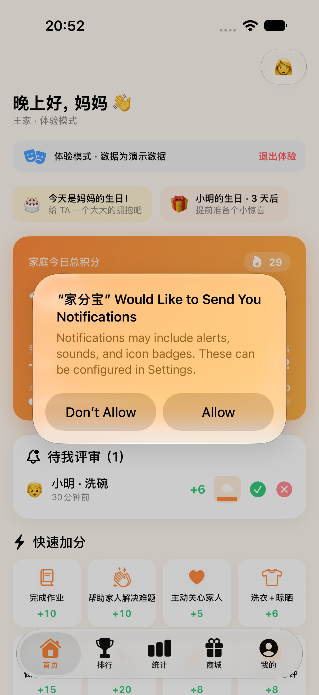
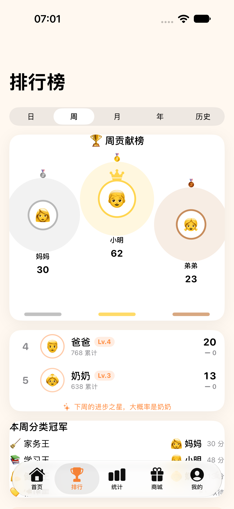
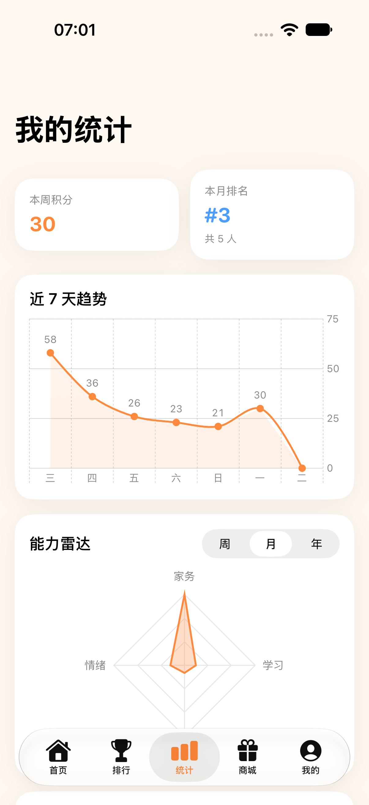
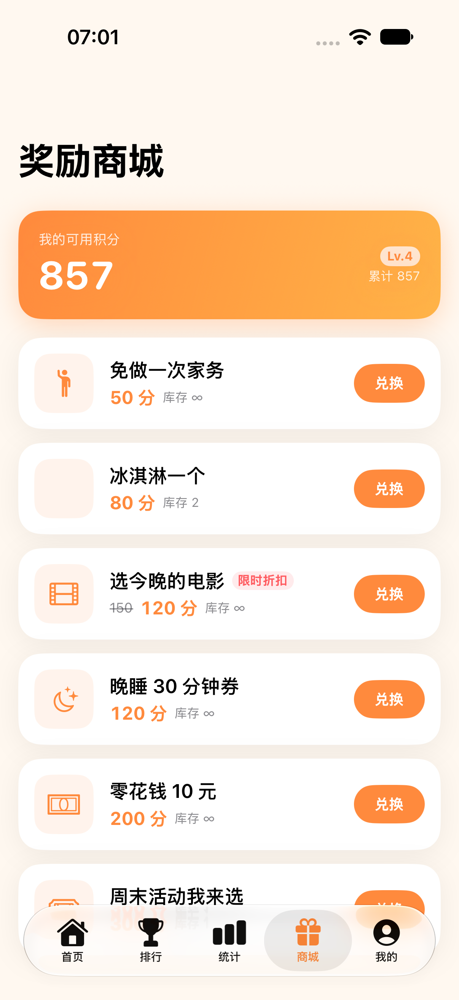

# 家分宝 FamilyScore 🏠⭐

> 每一分，都是爱。
> 把家务、学习、健康、情绪价值变成全家人的游戏——行为得分、排行榜见成长、积分换惊喜。

iPhone App（iOS 17+，SwiftUI + SwiftData）。当前为 **M1+M2 本地完整版**：创建家庭 → 打卡 → 排行 → 统计 → 兑换 → 审计，全链路可用。

---

## 长什么样

| 首页 | 排行榜 | 统计 | 商城 |
|------|--------|------|------|
|  |  |  |  |

深色模式、加分确认卡、我的页等全部截图见 [`docs/screenshots/`](docs/screenshots/)（浅色 `light_*` / 深色 `dark_*` 各 9 张）。

## 5 分钟上手

1. 用 Xcode（27+）打开 `FamilyScore.xcodeproj`
2. 选 iPhone 模拟器，按 ⌘R 运行
3. 欢迎页点 **「先体验一下（演示家庭）」**——内置"王家"五口人 × 30 天数据，排行、统计、商城立刻有内容
4. 想要真数据：回到欢迎页流程 **创建我的家庭**，选一套规则模板（三口之家 / 有老人 / 二胎 / 自定义），30 秒开张

> 体验模式与真实家庭互不干扰；演示家庭数据在本机数据库，随时可在模拟器「Delete App」清空重来。

## 全家怎么用

**你是家长（管理员）**
- 首页给家人「待确认」的加分一键通过/驳回；指派今日待办
- 发起减分（儿童不能自己扣分）；一切操作进「我的 → 审计日志」，异常自动提示但不自动处罚
- 「我的 → 积分规则」启停规则；「兑换核销」输码或点选核销孩子的奖励
- 「家庭管理」添加成员（孩子/家长/长辈）、让离家的成员退出（历史积分保留）

**你是孩子**
- 首页大按钮快速打卡：洗碗、阅读、运动……可附拍照凭证，家长评审通过后入账（家长自己打卡当场生效）
- 收到家长指派的今日待办，完成后打卡即自动勾销
- 看日/周/月榜，和上周的自己比（进步榜不制造焦虑）
- 商城攒分兑换：电影、冰淇淋、零花钱；不够分先放心愿单，攒够了提醒你
- 连续打卡 7/30/100 天有里程碑奖励和徽章

**你是长辈**
- 界面走超大字号系统辅助即可（动态字体全支持）；家人可代打卡

## 积分怎么算（家长速览）

| 规则 | 说明 |
|------|------|
| 实际得分 | 基础分 × 成员系数 × 活动倍率，四舍五入（孩子系数默认 1.2，可调） |
| 双轨 | 累计分只增不减（定等级）；可用分消费扣减 |
| 等级 | Lv.1 新芽 → Lv.10 传家宝，阈值见设计文档 §6.2.1 |
| 过期 | 积分按月批次记账，满 12 个月打五折转入永久池，永不清零；到期前 30 天商城提醒 |
| 防刷 | 单行为每日上限、5 分钟重复拦截、凭证当日去重、确认人每日 20 条上限 |
| 公平 | 记录只增不改（撤销=反向记录）；减分每日上限 −20；A1–A6 异常只报告不处罚 |

## 常见问题

- **怎么换人？** 首页右上角头像 → 切换成员（本机多角色演示/共用设备场景）
- **孩子乱点扣分？** 减分只能由家长发起，儿童提交的高频行为默认待家长确认
- **指派任务过期了怎么办？** 过期不自动扣分：任务转"过期"并从今日待办消失；家长首页"近期过期"卡片可对单条发起「未完成约定任务 −5」走确认流程，也可以直接翻篇；孩子只会看到"今天再打个卡一样加分"的温和提示
- **想退出体验模式？** 体验模式下首页顶部有「退出体验」，确认后清空演示数据回到开屏引导（也可以删 App 重装）
- **数据在哪？** 全部在本机（SwiftData）；iCloud 家庭共享同步属于 M3，接口已预留

## 开发者区

```bash
# 全量测试（43 单测 + UI 冒烟走查）
xcodebuild -project FamilyScore.xcodeproj -scheme FamilyScore \
  -destination 'platform=iOS Simulator,name=iPhone 18 Pro' test

# 重新生成 App 图标（1024×1024，方案 A 房子+星星+心）
swift scripts/gen_appicon.swift
```

- **设计文档**：[DESIGN.md](DESIGN.md)（终版 v2，唯一权威版本；v2 修订摘要见其 §22.5）
- **结构**：`Models`（12 实体）→ `Services`（积分引擎/排行/奖励/审计/模板/演示数据，纯逻辑不依赖 SwiftUI）→ `Features`（五 Tab + Onboarding）→ `Components`
- **交付边界**：本地闭环全部可用；CloudKit 同步、Widget、推送、地理提醒为 M3（协议接口+设计文档已备），Face ID 家长锁本次交付简化为角色权限+在场确认

## 路线图

- [x] M1 引擎与数据（全部实体 + 六大服务 + 单测全绿）
- [x] M2 全 UI（五 Tab + 引导 + 体验模式 + 动效触觉 + 深色模式 + 六项需求补齐）
- [x] M3 本地全量：通知全量（7 类+免打扰）、数据导出/导入、到家提醒、桌面+锁屏 Widget（一键打卡）、同步基础设施与云同步状态页
- [x] M4 本地可验证部分：内购会员（StoreKit 2 + 门槛）、App Store 素材（docs/appstore/）
- [ ] 待真实环境：CloudKit 真实推送/拉取、沙盒购买、家庭联赛（见 DESIGN.md §23.3）

## 新增能力速览（M3/M4）

- **通知中心**：待办汇总/生日/评审提醒/积分到期/周结算/打卡保护/目标达成，免打扰时段自动顺延（我的 → 通知设置）
- **小组件**：桌面"家庭积分卡"与锁屏"一键打卡"（长按桌面添加；打卡在评审制下于 App 打开时结算）
- **到家提醒**：通知设置里"把当前位置设为家"，到家且有未完成待办时提醒（1 小时冷却，坐标只在本机）
- **数据导出/导入**：我的 → 数据导出/导入（会员功能；支持分家导出）
- **云同步**：我的 → 云同步（无 iCloud 账号时本地模式，变更队列与导出兜底可用）
- **会员**：¥18/月 ¥128/年（模拟器走本地商店 Configuration.storekit），解锁无限成员/永久历史/全部模板/导出
